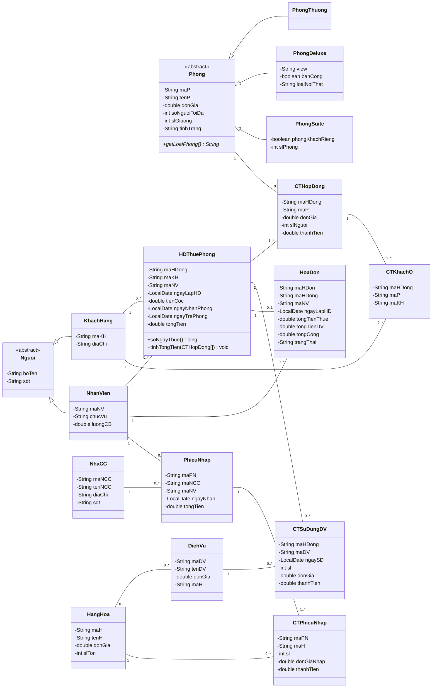

# Đồ án OOP — Quản lý khách sạn

## 1. Tổng quan

Chương trình console quản lý một khách sạn nhỏ, viết bằng **Java**, lưu dữ liệu bằng **file `.txt`**.

Nghiệp vụ:

- **Phòng**: 3 loại phòng là thường, Deluxe và Suite, cùng kế thừa từ lớp trừu tượng `Phong`.
- **Khách hàng**: lưu thông tin người thuê.
- **Thuê phòng**: lập hợp đồng thuê. Một hợp đồng thuê được nhiều phòng, mỗi phòng có thể có nhiều khách ở. Mọi phòng trong cùng một hợp đồng nhận và trả cùng ngày.
- **Dịch vụ và thanh toán**: khách dùng dịch vụ trong thời gian ở; lúc trả phòng lập hóa đơn gồm tiền phòng và tiền dịch vụ.
- **Nhân sự, kho**: nhân viên lập hợp đồng, hóa đơn, phiếu nhập. Hàng hóa nhập từ nhà cung cấp vào kho và bị trừ dần khi khách dùng dịch vụ có tiêu hao hàng.
- **Thống kê**: doanh thu, tình trạng phòng, tồn kho.

Chương trình chia thành 4 module:

| Module | Lớp đối tượng | Danh sách | Menu |
|---|---|---|---|
| Phòng & Khách hàng | `Nguoi`, `KhachHang`, `Phong`, `PhongThuong`, `PhongDeluxe`, `PhongSuite` | `DSPhong`, `DSKhachHang` | `MenuPhong`, `MenuKhachHang` |
| Thuê phòng | `HDThuePhong`, `CTHopDong`, `CTKhachO` | `DSHDThuePhong`, `DSCTHopDong`, `DSCTKhachO` | `MenuThuePhong` |
| Dịch vụ & Thanh toán | `DichVu`, `CTSuDungDV`, `HoaDon` | `DSDichVu`, `DSCTSuDungDV`, `DSHoaDon` | `MenuDichVu`, `MenuHoaDon` |
| Nhân sự, Kho & Thống kê | `NhanVien`, `NhaCC`, `HangHoa`, `PhieuNhap`, `CTPhieuNhap` | `DSNhanVien`, `DSNhaCC`, `DSHangHoa`, `DSPhieuNhap`, `DSCTPhieuNhap` | `MenuNhanVien`, `MenuKho`, `MenuThongKe` |

## 2. Quy ước chung

### 2.1 Môi trường

- Java 8 trở lên, chỉ dùng thư viện chuẩn (`java.util`, `java.io`, `java.nio`, `java.time`). Không dùng thư viện ngoài.
- Không phụ thuộc IDE: mở được bằng IntelliJ, VS Code, Eclipse hoặc `javac`.
- Chạy chương trình từ **thư mục gốc project**, vì đường dẫn file dữ liệu là đường dẫn tương đối `data/...`.
- File dữ liệu đọc/ghi bằng **UTF-8**.

### 2.2 Cấu trúc thư mục

```text
src/
  app/        Main.java (menu chính), DuLieu.java (giữ các danh sách dùng chung)
  core/       NhapLieu.java (hàm kiểm tra nhập, nhận Scanner qua tham số), DinhDang.java (ngày, tiền, dòng file),
              DoiTuong.java (interface của lớp đối tượng), DanhSach.java (interface của lớp danh sách)
  model/      17 lớp đối tượng (mục 2.8, 3, 4)
  danhsach/   13 lớp danh sách DSxxx, mỗi lớp quản lý một mảng (mục 2.9)
  menu/       MenuPhong, MenuKhachHang, MenuThuePhong, MenuDichVu,
              MenuHoaDon, MenuNhanVien, MenuKho, MenuThongKe
data/         13 file .txt (mục 5)
```

### 2.3 Đặt tên

- Tên lớp, thuộc tính, phương thức: tiếng Việt **không dấu**, đúng như sơ đồ (`PhongDeluxe`, `soNguoiToiDa`, `timTheoMa`).
- Lớp viết `PascalCase`, thuộc tính và phương thức viết `camelCase`. Package viết thường.
- Thuộc tính luôn `private`, truy cập qua getter/setter (`getDonGia()`, `setDonGia(...)`). Riêng `boolean` dùng `isBanCong()`.
- Chữ hiển thị cho người dùng (menu, thông báo) viết tiếng Việt có dấu.

### 2.4 Mã đối tượng

Mã do chương trình **tự sinh** bằng hàm `sinhMa()` của danh sách, người dùng không nhập. Mã gồm tiền tố cộng số thứ tự 3 chữ số; số mới bằng số lớn nhất đang có cộng 1 (không dùng `n + 1`, vì xóa giữa chừng sẽ sinh ra mã trùng).

| Lớp | Tiền tố | Ví dụ |
|---|---|---|
| `Phong` | `P` | `P001` |
| `KhachHang` | `KH` | `KH001` |
| `NhanVien` | `NV` | `NV001` |
| `HDThuePhong` | `HDTP` | `HDTP001` |
| `HoaDon` | `HDON` | `HDON001` |
| `DichVu` | `DV` | `DV001` |
| `HangHoa` | `HH` | `HH001` |
| `NhaCC` | `NCC` | `NCC001` |
| `PhieuNhap` | `PN` | `PN001` |

Các lớp chi tiết (`CTHopDong`, `CTKhachO`, `CTSuDungDV`, `CTPhieuNhap`) không có mã riêng. Chúng được nhận diện bằng mã của các lớp chúng nối tới.

### 2.5 Kiểu dữ liệu

| Loại | Kiểu Java | Ghi chú |
|---|---|---|
| Mã, chữ | `String` | Không được chứa ký tự `\|` |
| Tiền | `double` | Đơn vị VNĐ |
| Số lượng | `int` | |
| Có/không | `boolean` | Trong file ghi `true` / `false` |
| Ngày | `java.time.LocalDate` | Hiển thị, nhập và lưu file theo dạng `dd/MM/yyyy` |
| Số ngày | `long` | `ChronoUnit.DAYS.between(ngayNhan, ngayTra)` |

### 2.6 Giá trị cố định

| Thuộc tính | Giá trị |
|---|---|
| `Phong.tinhTrang` | `TRONG`, `DA_THUE` |
| `HoaDon.trangThai` | `CHUA_TT`, `DA_TT` |
| Loại phòng (trong file) | `THUONG`, `DELUXE`, `SUITE` |

Khai báo các giá trị này thành hằng `public static final String` trong lớp tương ứng (ví dụ `Phong.TRONG`) và dùng hằng thay vì gõ chuỗi trực tiếp.

### 2.7 Menu

Menu chính:

```text
1. Quản lý phòng
2. Quản lý khách hàng
3. Thuê phòng
4. Dịch vụ
5. Trả phòng & hóa đơn
6. Nhân viên
7. Kho (nhà cung cấp, hàng hóa, phiếu nhập)
8. Thống kê
0. Thoát
```

- Mỗi mục mở một menu con, lặp cho tới khi người dùng chọn `0. Quay lại`.
- Mỗi menu danh mục (phòng, khách hàng, nhân viên, dịch vụ, hàng hóa, nhà cung cấp) có tối thiểu: thêm, sửa, xóa, tìm theo mã, xem tất cả.
- Nhập sai (gõ chữ vào ô số, ngày không hợp lệ…) thì báo lỗi và hỏi lại, không làm chương trình dừng.
- Menu gọi các hàm **không tham số** của danh sách, ví dụ `DuLieu.dsKhachHang.them()`.
- Sau mỗi thao tác thêm/sửa/xóa, menu gọi `ghiFile()` của các danh sách vừa thay đổi.

### 2.8 Cách viết lớp đối tượng (`model/`)

Mỗi lớp có:

- Thuộc tính `private` như mục 4.
- 3 constructor: **không tham số**, **đầy đủ tham số**, **sao chép** (nhận một đối tượng cùng lớp và chép từng thuộc tính).
- Getter/setter.
- `nhap()`: nhập các trường người dùng gõ vào bằng **`Scanner` riêng của lớp** (mục 2.10), kiểm tra qua các hàm của `core.NhapLieu`. Không nhập mã (danh sách tự sinh), không nhập mã liên kết (`maKH`, `maP`…) và trường tính toán (`thanhTien`…); các trường này gán bằng setter.
- `xuat()`: in thông tin ra màn hình.
- `toLine()`: trả về một dòng file theo mục 5, viết bằng `DinhDang.dong(...)`.

Lớp con gọi `super(...)`, `super.nhap()`, `super.xuat()`, `super.toLine()` rồi thêm phần riêng. `Nguoi` và `Phong` là lớp abstract; `Phong` có thêm phương thức abstract `getLoaiPhong()`. Ví dụ:

```java
// Phong
public String toLine() {
    return DinhDang.dong(getLoaiPhong(), maP, tenP, donGia, soNguoiToiDa, slGiuong, tinhTrang);
}

// PhongDeluxe
public String toLine() {
    return super.toLine() + DinhDang.PHAN_CACH + DinhDang.dong(view, banCong, loaiNoiThat);
}
```

### 2.9 Cách viết lớp danh sách (`danhsach/`)

Mỗi danh sách tự quản lý **một mảng** `ds` và biến đếm `n`. Mảng luôn có đúng `n` phần tử: thêm thì nới mảng ra 1 bằng `Arrays.copyOf(ds, n + 1)`, xóa thì dời các phần tử phía sau lên rồi thu mảng lại 1.

Mỗi chức năng có **cặp hàm cùng tên**: hàm không tham số nhập dữ liệu từ bàn phím rồi gọi hàm có tham số. Hàm có tham số dùng được ở module khác; hàm `timTheoMa(ma)` **chỉ trả về, không in**.

Các hàm bắt buộc:

| Hàm | Danh sách có mã (`DSPhong`, `DSHoaDon`…) | Danh sách chi tiết (`DSCTHopDong`…) |
|---|---|---|
| `getDs()`, `getN()` | ✓ | ✓ |
| `them()`, `them(x)` | ✓ | chỉ `them(x)` |
| `timTheoMa()`, `timTheoMa(ma)` | ✓ | thay bằng các hàm `layTheo...` ở mục 6.6 |
| `sua()`, `sua(ma)` | ✓ danh mục; chứng từ sửa theo mục 6 | |
| `xoa()`, `xoa(ma)` | chỉ danh mục (mục 6.5) | |
| `xuat()`, `docFile()`, `ghiFile()` | ✓ | ✓ |
| `sinhMa()` | ✓ | |

Sáu hàm chung của mọi danh sách (`getDs()`, `getN()`, `them(x)`, `xuat()`, `docFile()`, `ghiFile()`) được khai báo trong interface `core.DanhSach<T>`. Mỗi lớp danh sách `implements DanhSach<X>` (ví dụ `DSKhachHang implements DanhSach<KhachHang>`) và ghi `@Override` trên 6 hàm đó.

Mẫu đầy đủ (`DSKhachHang`):

```java
package danhsach;

import core.DanhSach;
import core.NhapLieu;
import core.TepTin;
import java.util.Arrays;
import java.util.Scanner;
import model.KhachHang;

public class DSKhachHang implements DanhSach<KhachHang> {
    private static final Scanner sc = new Scanner(System.in, "UTF-8");
    private static final String FILE = "data/khachhang.txt";
    private KhachHang[] ds = new KhachHang[0];
    private int n = 0;

    @Override
    public KhachHang[] getDs() {
        return ds;
    }

    @Override
    public int getN() {
        return n;
    }

    // Thêm (không tham số): nhập từ bàn phím, tự sinh mã
    public void them() {
        KhachHang kh = new KhachHang();
        kh.nhap();
        kh.setMaKH(sinhMa());
        them(kh);
        System.out.println("Đã thêm khách hàng " + kh.getMaKH());
    }

    // Thêm (có tham số)
    @Override
    public void them(KhachHang kh) {
        ds = Arrays.copyOf(ds, n + 1);
        ds[n++] = new KhachHang(kh);
    }

    // Tìm theo mã (không tham số): nhập mã rồi in kết quả
    public void timTheoMa() {
        String ma = NhapLieu.nhapChuoi(sc, "Nhập mã khách hàng cần tìm");
        KhachHang kh = timTheoMa(ma);
        if (kh == null) {
            System.out.println("Không tìm thấy khách hàng có mã: " + ma);
        } else {
            kh.xuat();
        }
    }

    // Tìm theo mã (có tham số): chỉ trả về, không in, không thấy thì trả null
    public KhachHang timTheoMa(String ma) {
        for (int i = 0; i < n; i++) {
            if (ds[i].getMaKH().equalsIgnoreCase(ma)) {
                return ds[i];
            }
        }
        return null;
    }

    // Sửa (không tham số)
    public void sua() {
        String ma = NhapLieu.nhapChuoi(sc, "Nhập mã khách hàng cần sửa");
        sua(ma);
    }

    // Sửa (có tham số): nhập lại thông tin, giữ nguyên mã
    public void sua(String ma) {
        KhachHang kh = timTheoMa(ma);
        if (kh == null) {
            System.out.println("Không tìm thấy khách hàng có mã: " + ma);
            return;
        }
        kh.nhap();
        System.out.println("Đã cập nhật khách hàng " + kh.getMaKH());
    }

    // Xóa (không tham số)
    public void xoa() {
        String ma = NhapLieu.nhapChuoi(sc, "Nhập mã khách hàng cần xóa");
        xoa(ma);
    }

    // Xóa (có tham số): dời các phần tử phía sau lên rồi thu mảng lại 1
    public void xoa(String ma) {
        for (int i = 0; i < n; i++) {
            if (ds[i].getMaKH().equalsIgnoreCase(ma)) {
                for (int j = i; j < n - 1; j++) {
                    ds[j] = ds[j + 1];
                }
                ds = Arrays.copyOf(ds, n - 1);
                n--;
                System.out.println("Đã xóa khách hàng có mã: " + ma);
                return;
            }
        }
        System.out.println("Không tìm thấy khách hàng có mã: " + ma);
    }

    @Override
    public void xuat() {
        if (n == 0) {
            System.out.println("Danh sách trống.");
            return;
        }
        for (int i = 0; i < n; i++) {
            ds[i].xuat();
        }
    }

    // mã mới = số lớn nhất đang có + 1
    public String sinhMa() {
        int max = 0;
        for (int i = 0; i < n; i++) {
            int so = Integer.parseInt(ds[i].getMaKH().substring(2));
            if (so > max) {
                max = so;
            }
        }
        return String.format("KH%03d", max + 1);
    }

    // TepTin.doc trả về mảng các dòng, mỗi dòng đã tách sẵn thành mảng trường t
    // dòng nào hỏng (thiếu trường, sai số, sai ngày) thì bỏ qua, không làm dừng chương trình
    @Override
    public void docFile() {
        ds = new KhachHang[0];
        n = 0;
        for (String[] t : TepTin.doc(FILE)) {
            try {
                them(new KhachHang(t[0], t[1], t[2], t[3]));
            } catch (Exception e) {
                System.out.println("Bỏ qua 1 dòng lỗi trong " + FILE);
            }
        }
    }

    // đổi từng đối tượng thành 1 dòng rồi nhờ TepTin ghi đè cả file
    @Override
    public void ghiFile() {
        String[] cacDong = new String[n];
        for (int i = 0; i < n; i++) {
            cacDong[i] = ds[i].toLine();
        }
        TepTin.ghi(FILE, cacDong);
    }
}
```

Với lớp có lớp con (`DSPhong`):

- `them()` hỏi loại phòng trước, tạo đúng lớp con rồi mới gọi `nhap()`.
- `them(Phong p)` chép bằng constructor sao chép của đúng lớp con:

  ```java
  ds = Arrays.copyOf(ds, n + 1);
  if (p instanceof PhongDeluxe) {
      ds[n++] = new PhongDeluxe((PhongDeluxe) p);
  } else if (p instanceof PhongSuite) {
      ds[n++] = new PhongSuite((PhongSuite) p);
  } else {
      ds[n++] = new PhongThuong((PhongThuong) p);
  }
  ```

- `docFile()` đọc trường đầu (`t[0]` là `THUONG` / `DELUXE` / `SUITE`) để biết tạo lớp con nào.

Hàm trả về nhiều kết quả (mục 6.6) trả về **mảng**, gom kết quả bằng `Arrays.copyOf`:

```java
public Phong[] dsPhongTrong() {
    Phong[] kq = new Phong[0];
    for (int i = 0; i < n; i++) {
        if (ds[i].getTinhTrang().equals(Phong.TRONG)) {
            kq = Arrays.copyOf(kq, kq.length + 1);
            kq[kq.length - 1] = ds[i];
        }
    }
    return kq;
}
```

Mỗi danh sách được tạo **đúng một lần** trong `app/DuLieu.java`. Mảng `DanhSach<?>[] TAT_CA` gom cả 13 danh sách, và `DuLieu.docTatCa()` duyệt mảng này để gọi `docFile()`. Module khác dùng `DuLieu.dsKhachHang`, không tự `new DSKhachHang()`:

```java
public static final DSKhachHang dsKhachHang = new DSKhachHang();   // khai báo trong DuLieu
private static final DanhSach<?>[] TAT_CA = { dsPhong, dsKhachHang, ... };   // thêm vào mảng
```

### 2.10 Nhập từ bàn phím

- Lớp nào cần đọc bàn phím thì **tự khởi tạo `Scanner` riêng** ở đầu lớp, không lấy Scanner từ lớp khác:

  ```java
  private static final Scanner sc = new Scanner(System.in, "UTF-8");
  ```

- `core.NhapLieu` **không giữ Scanner**. Nó chỉ chứa các hàm kiểm tra (sai thì báo lỗi và hỏi lại) và nhận Scanner qua tham số: `NhapLieu.nhapChuoi(sc, "Họ tên")`, `NhapLieu.chonMenu(sc, "KHO", "Quay lại", ...)`.
- Luôn đọc cả dòng (`nextLine()`) rồi tự chuyển kiểu, không dùng `nextInt()`, để không bị trôi lệnh nhập phía sau.
- Không gọi `sc.close()`: lệnh này đóng luôn `System.in`, các lớp khác sẽ không nhập được nữa.
- Mỗi Scanner có bộ đệm riêng, nên chỉ gõ (hoặc dán) **từng dòng một**. Nếu dán nhiều dòng cùng lúc, hoặc chạy `java app.Main < input.txt`, Scanner nhận dữ liệu trước sẽ giữ luôn các dòng phía sau.

## 3. Sơ đồ lớp đối tượng



Sơ đồ chỉ ghi thuộc tính và phương thức đặc trưng. Getter/setter, constructor, `nhap()`, `xuat()`, `toLine()` lớp nào cũng có (mục 2.8) nên không vẽ lại.

Bản PlantUML ở [`docs/SO_DO_LOP.puml`](docs/SO_DO_LOP.puml) gồm 2 sơ đồ: sơ đồ lớp đối tượng như trên (có thêm interface `DoiTuong`), và sơ đồ kiến trúc các tầng `app` / `menu` / `danhsach` / `core` với interface `DanhSach<T>`.

### Cách đọc sơ đồ

- `A <|-- B`: **kế thừa**. B có mọi thuộc tính của A, thêm phần riêng. Lớp `<<abstract>>` không tạo đối tượng trực tiếp; phương thức có dấu `*` là abstract.
- `A "1" -- "0..*" B`: một A liên quan tới nhiều B. Bên B luôn có một thuộc tính chứa mã của A (ví dụ `CTHopDong.maP` → `Phong.maP`).
- `HangHoa "0..1" -- "0..*" DichVu`: một dịch vụ dùng **không hoặc một** loại hàng (ví dụ "Nước suối" dùng hàng nước suối, "Giặt ủi" không dùng hàng).
- Các lớp `CT...` (chi tiết) tách quan hệ nhiều–nhiều:
  - `CTHopDong`: hợp đồng nào thuê phòng nào, bao nhiêu người, giá bao nhiêu.
  - `CTKhachO`: nối `CTHopDong` (qua `maHDong` + `maP`) với `KhachHang`, cho biết khách nào ở phòng nào trong hợp đồng nào.
  - `CTSuDungDV`: hợp đồng nào dùng dịch vụ gì, ngày nào.
  - `CTPhieuNhap`: phiếu nhập nào nhập hàng gì, bao nhiêu.

## 4. Mô tả lớp

### 4.1 Người

#### `Nguoi` (abstract)

Phần chung của mọi người trong hệ thống.

| Thuộc tính | Kiểu | Ý nghĩa |
|---|---|---|
| `hoTen` | `String` | Họ tên |
| `sdt` | `String` | Số điện thoại, 10 chữ số, bắt đầu bằng `0` |

#### `KhachHang` extends `Nguoi`

Người thuê phòng hoặc ở cùng trong phòng.

| Thuộc tính | Kiểu | Ý nghĩa |
|---|---|---|
| `maKH` | `String` | Mã khách hàng |
| `diaChi` | `String` | Địa chỉ |

#### `NhanVien` extends `Nguoi`

Người lập hợp đồng, hóa đơn, phiếu nhập.

| Thuộc tính | Kiểu | Ý nghĩa |
|---|---|---|
| `maNV` | `String` | Mã nhân viên |
| `chucVu` | `String` | Chức vụ (lễ tân, quản lý, thủ kho…) |
| `luongCB` | `double` | Lương cơ bản, ≥ 0 |

### 4.2 Phòng

#### `Phong` (abstract)

Phần chung của mọi loại phòng.

| Thuộc tính | Kiểu | Ý nghĩa |
|---|---|---|
| `maP` | `String` | Mã phòng |
| `tenP` | `String` | Số phòng (ví dụ `101`), không trùng |
| `donGia` | `double` | Giá thuê một ngày, > 0 |
| `soNguoiToiDa` | `int` | Số người ở tối đa, ≥ 1 |
| `slGiuong` | `int` | Số giường, ≥ 1 |
| `tinhTrang` | `String` | `TRONG` / `DA_THUE` |

| Phương thức | Ý nghĩa |
|---|---|
| `getLoaiPhong()` (abstract) | Lớp con trả về `THUONG` / `DELUXE` / `SUITE` |

#### `PhongThuong` extends `Phong`

Phòng tiêu chuẩn, không có thuộc tính riêng.

#### `PhongDeluxe` extends `Phong`

| Thuộc tính | Kiểu | Ý nghĩa |
|---|---|---|
| `view` | `String` | Hướng nhìn của phòng |
| `banCong` | `boolean` | Có ban công hay không |
| `loaiNoiThat` | `String` | Loại nội thất |

#### `PhongSuite` extends `Phong`

| Thuộc tính | Kiểu | Ý nghĩa |
|---|---|---|
| `phongKhachRieng` | `boolean` | Có phòng khách riêng hay không |
| `slPhong` | `int` | Số phòng con trong suite, ≥ 2 |

### 4.3 Thuê phòng

#### `HDThuePhong`

Hợp đồng thuê phòng của một khách đứng tên.

| Thuộc tính | Kiểu | Ý nghĩa |
|---|---|---|
| `maHDong` | `String` | Mã hợp đồng |
| `maKH` | `String` | Khách đứng tên → `KhachHang` |
| `maNV` | `String` | Nhân viên lập → `NhanVien` |
| `ngayLapHD` | `LocalDate` | Ngày lập hợp đồng |
| `tienCoc` | `double` | Tiền đặt cọc, ≥ 0 |
| `ngayNhanPhong` | `LocalDate` | Ngày nhận phòng, chung cho mọi phòng trong hợp đồng |
| `ngayTraPhong` | `LocalDate` | Ngày trả phòng, chung cho mọi phòng trong hợp đồng, sau `ngayNhanPhong` |
| `tongTien` | `double` | Tổng `thanhTien` của các `CTHopDong` thuộc hợp đồng (tiền phòng, chưa gồm dịch vụ) |

| Phương thức | Ý nghĩa |
|---|---|
| `soNgayThue()` | Số ngày giữa `ngayNhanPhong` và `ngayTraPhong` |
| `tinhTongTien(CTHopDong[])` | Cộng `thanhTien` các phòng của hợp đồng vào `tongTien` |

#### `CTHopDong`

Một phòng được thuê trong hợp đồng. Cặp (`maHDong`, `maP`) không trùng.

| Thuộc tính | Kiểu | Ý nghĩa |
|---|---|---|
| `maHDong` | `String` | → `HDThuePhong` |
| `maP` | `String` | → `Phong` |
| `donGia` | `double` | Giá phòng **tại lúc thuê**, chép từ `Phong.donGia` |
| `slNguoi` | `int` | Số người ở phòng này, từ 1 tới `Phong.soNguoiToiDa` |
| `thanhTien` | `double` | `donGia` × `soNgayThue()` của hợp đồng |

#### `CTKhachO`

Một khách ở một phòng trong hợp đồng. Bộ (`maHDong`, `maP`, `maKH`) không trùng.

| Thuộc tính | Kiểu | Ý nghĩa |
|---|---|---|
| `maHDong`, `maP` | `String` | → `CTHopDong` |
| `maKH` | `String` | → `KhachHang` |

### 4.4 Dịch vụ, thanh toán

#### `DichVu`

Dịch vụ khách sạn cung cấp (đồ uống, giặt ủi, ăn sáng…).

| Thuộc tính | Kiểu | Ý nghĩa |
|---|---|---|
| `maDV` | `String` | Mã dịch vụ |
| `tenDV` | `String` | Tên dịch vụ |
| `donGia` | `double` | Giá bán một lần dùng, > 0 |
| `maH` | `String` | Hàng hóa bị tiêu hao khi dùng → `HangHoa`; chuỗi rỗng `""` nếu dịch vụ không dùng hàng |

#### `CTSuDungDV`

Một lần khách dùng dịch vụ trong thời gian thuê.

| Thuộc tính | Kiểu | Ý nghĩa |
|---|---|---|
| `maHDong` | `String` | → `HDThuePhong` |
| `maDV` | `String` | → `DichVu` |
| `ngaySD` | `LocalDate` | Ngày sử dụng, trong khoảng `ngayNhanPhong` – `ngayTraPhong` |
| `sl` | `int` | Số lượng, ≥ 1 |
| `donGia` | `double` | Giá dịch vụ tại lúc dùng, chép từ `DichVu.donGia` |
| `thanhTien` | `double` | `sl` × `donGia` |

#### `HoaDon`

Hóa đơn thanh toán, lập lúc trả phòng. Mỗi hợp đồng có tối đa một hóa đơn.

| Thuộc tính | Kiểu | Ý nghĩa |
|---|---|---|
| `maHDon` | `String` | Mã hóa đơn |
| `maHDong` | `String` | → `HDThuePhong` |
| `maNV` | `String` | Nhân viên lập → `NhanVien` |
| `ngayLapHD` | `LocalDate` | Ngày lập hóa đơn |
| `tongTienThue` | `double` | Tổng `thanhTien` của các `CTHopDong` thuộc hợp đồng |
| `tongTienDV` | `double` | Tổng `thanhTien` của các `CTSuDungDV` thuộc hợp đồng |
| `tongCong` | `double` | `tongTienThue` + `tongTienDV` |
| `trangThai` | `String` | `CHUA_TT` / `DA_TT` |

### 4.5 Kho

#### `NhaCC`

Nhà cung cấp hàng hóa.

| Thuộc tính | Kiểu | Ý nghĩa |
|---|---|---|
| `maNCC` | `String` | Mã nhà cung cấp |
| `tenNCC` | `String` | Tên nhà cung cấp |
| `diaChi` | `String` | Địa chỉ |
| `sdt` | `String` | Số điện thoại |

#### `HangHoa`

Hàng trong kho, dùng cho dịch vụ.

| Thuộc tính | Kiểu | Ý nghĩa |
|---|---|---|
| `maH` | `String` | Mã hàng |
| `tenH` | `String` | Tên hàng |
| `donGia` | `double` | Giá nhập của lần nhập gần nhất (thêm mới thì nhập tay, sau đó cập nhật tự động mỗi lần nhập hàng) |
| `slTon` | `int` | Số lượng còn trong kho, ≥ 0. Thêm mới bằng 0; cộng khi nhập, trừ khi dùng dịch vụ |

#### `PhieuNhap`

Một lần nhập hàng từ nhà cung cấp.

| Thuộc tính | Kiểu | Ý nghĩa |
|---|---|---|
| `maPN` | `String` | Mã phiếu nhập |
| `maNCC` | `String` | → `NhaCC` |
| `maNV` | `String` | Nhân viên lập → `NhanVien` |
| `ngayNhap` | `LocalDate` | Ngày nhập |
| `tongTien` | `double` | Tổng `thanhTien` các dòng `CTPhieuNhap` |

#### `CTPhieuNhap`

Một mặt hàng trong phiếu nhập. Cặp (`maPN`, `maH`) không trùng.

| Thuộc tính | Kiểu | Ý nghĩa |
|---|---|---|
| `maPN` | `String` | → `PhieuNhap` |
| `maH` | `String` | → `HangHoa` |
| `sl` | `int` | Số lượng nhập, ≥ 1 |
| `donGiaNhap` | `double` | Giá nhập lần này, > 0 |
| `thanhTien` | `double` | `sl` × `donGiaNhap` |

## 5. Lưu trữ

Mỗi danh sách một file trong `data/`, mỗi dòng một đối tượng, các trường nối bằng `|` theo đúng thứ tự dưới đây. Lớp con ghi trường của lớp cha trước. Ngày ghi dạng `dd/MM/yyyy`, `boolean` ghi `true`/`false`.

| File | Thứ tự trường |
|---|---|
| `phong.txt` | `loai\|maP\|tenP\|donGia\|soNguoiToiDa\|slGiuong\|tinhTrang` + phần riêng: Deluxe `\|view\|banCong\|loaiNoiThat`, Suite `\|phongKhachRieng\|slPhong` |
| `khachhang.txt` | `maKH\|hoTen\|sdt\|diaChi` |
| `nhanvien.txt` | `maNV\|hoTen\|sdt\|chucVu\|luongCB` |
| `hdthuephong.txt` | `maHDong\|maKH\|maNV\|ngayLapHD\|tienCoc\|ngayNhanPhong\|ngayTraPhong\|tongTien` |
| `cthopdong.txt` | `maHDong\|maP\|donGia\|slNguoi\|thanhTien` |
| `ctkhacho.txt` | `maHDong\|maP\|maKH` |
| `dichvu.txt` | `maDV\|tenDV\|donGia\|maH` |
| `ctsudungdv.txt` | `maHDong\|maDV\|ngaySD\|sl\|donGia\|thanhTien` |
| `hoadon.txt` | `maHDon\|maHDong\|maNV\|ngayLapHD\|tongTienThue\|tongTienDV\|tongCong\|trangThai` |
| `nhacc.txt` | `maNCC\|tenNCC\|diaChi\|sdt` |
| `hanghoa.txt` | `maH\|tenH\|donGia\|slTon` |
| `phieunhap.txt` | `maPN\|maNCC\|maNV\|ngayNhap\|tongTien` |
| `ctphieunhap.txt` | `maPN\|maH\|sl\|donGiaNhap\|thanhTien` |

Ví dụ:

```text
phong.txt
THUONG|P001|101|300000|2|1|TRONG
DELUXE|P002|201|600000|2|1|DA_THUE|Biển|true|Gỗ sồi
SUITE|P003|301|1200000|4|2|TRONG|true|2

dichvu.txt
DV001|Nước suối|15000|HH001
DV002|Giặt ủi|50000|

hdthuephong.txt
HDTP001|KH001|NV001|16/11/2026|500000|16/11/2026|18/11/2026|600000
```

## 6. Nghiệp vụ và ràng buộc

### 6.1 Phòng & Khách hàng

- Phòng mới có `tinhTrang = TRONG`. Menu phòng **không cho sửa tay** `tinhTrang`; chỉ module Thuê phòng và Hóa đơn đổi qua `capNhatTinhTrang`.
- Khi thêm phòng, người dùng chọn loại phòng trước, sau đó chương trình tạo đúng lớp con rồi gọi `nhap()`.
- `tenP` của phòng và `sdt` của khách hàng không trùng.

### 6.2 Thuê phòng

Lập hợp đồng:

1. Tìm khách đứng tên theo mã hoặc SĐT; chưa có thì thêm mới.
2. Chọn nhân viên lập, nhập `ngayNhanPhong`, `ngayTraPhong`, `tienCoc`. `ngayLapHD` là ngày hiện tại, `ngayNhanPhong` không trước `ngayLapHD`.
3. Chọn từ 1 phòng trở lên trong danh sách phòng `TRONG`. Với mỗi phòng: nhập `slNguoi`, chép `donGia` từ phòng, tính `thanhTien`.
4. Với mỗi phòng, ghi khách ở (`CTKhachO`): từ 1 tới `slNguoi` khách, chưa có thì thêm khách mới.
5. Tính `tongTien` của hợp đồng = tổng `thanhTien` các phòng đã chọn.
6. Mọi phòng đã chọn chuyển sang `DA_THUE` ngay khi lập hợp đồng. Chương trình không xử lý đặt phòng trước theo lịch.

Khi hợp đồng **chưa có hóa đơn**, được sửa `ngayTraPhong` (khách trả sớm hoặc ở thêm); sửa xong thì tính lại `thanhTien` của các `CTHopDong` thuộc hợp đồng và `tongTien` của hợp đồng. Khi đã có hóa đơn thì hợp đồng không sửa được nữa.

### 6.3 Dịch vụ & Thanh toán

Ghi dịch vụ:

- Chỉ ghi cho hợp đồng chưa có hóa đơn; `ngaySD` nằm trong khoảng nhận–trả phòng.
- Nếu dịch vụ có `maH`, gọi `DSHangHoa.truKho(maH, sl)`. Trả về `false` (không đủ hàng) thì báo lỗi và không ghi dịch vụ.

Trả phòng (lập hóa đơn):

1. Chọn hợp đồng chưa có hóa đơn và nhân viên lập.
2. Tính `tongTienThue`, `tongTienDV`, `tongCong`; `trangThai = CHUA_TT`.
3. Mọi phòng của hợp đồng chuyển về `TRONG`.
4. Khi in hóa đơn, hiển thị thêm **số còn phải trả** = `tongCong` − `tienCoc` (không lưu).
5. Thanh toán: đổi `trangThai` sang `DA_TT`.

### 6.4 Nhân sự, Kho & Thống kê

Nhập hàng:

1. Chọn nhà cung cấp và nhân viên lập; `ngayNhap` là ngày hiện tại.
2. Thêm từ 1 mặt hàng trở lên, mỗi hàng nhập `sl`, `donGiaNhap`; tính `thanhTien`.
3. Với mỗi hàng: gọi `DSHangHoa.congKho(maH, sl)` và cập nhật `HangHoa.donGia = donGiaNhap`.
4. Tính `tongTien` của phiếu.

Thống kê (tối thiểu):

- Doanh thu theo tháng/năm: tổng `tongCong` của các hóa đơn `DA_TT` có `ngayLapHD` trong tháng/năm đó.
- Doanh thu theo phòng (mục 7).
- Số phòng `TRONG` / `DA_THUE` theo từng loại phòng.
- Tồn kho: danh sách hàng hóa và `slTon`.

### 6.5 Xóa

- Không xóa chứng từ và chi tiết: `HDThuePhong`, `CTHopDong`, `CTKhachO`, `CTSuDungDV`, `HoaDon`, `PhieuNhap`, `CTPhieuNhap`.
- Danh mục (phòng, khách hàng, nhân viên, dịch vụ, hàng hóa, nhà cung cấp) chỉ xóa được khi **chưa được tham chiếu** ở đâu. Kiểm tra trong `xoa(ma)` bằng cách duyệt mảng của danh sách liên quan qua `DuLieu`. Ví dụ xóa phòng:

```java
for (CTHopDong ct : DuLieu.dsCTHopDong.getDs()) {
    if (ct.getMaP().equalsIgnoreCase(ma)) {
        System.out.println("Phòng đã có trong hợp đồng, không xóa được.");
        return;
    }
}
```

### 6.6 Hàm giao tiếp giữa các module

Ngoài các hàm bắt buộc ở mục 2.9, các danh sách cung cấp thêm:

| Hàm | Trả về | Dùng để |
|---|---|---|
| `DSPhong.dsPhongTrong()` | `Phong[]` | Liệt kê phòng `TRONG` khi lập hợp đồng |
| `DSPhong.capNhatTinhTrang(String maP, String tinhTrang)` | `void` | Đổi tình trạng phòng và ghi file |
| `DSKhachHang.timTheoSdt(String sdt)` | `KhachHang` | Tìm khách khi lập hợp đồng; không thấy thì `null` |
| `DSCTHopDong.layTheoHopDong(String maHDong)` | `CTHopDong[]` | Lấy các phòng của hợp đồng (tính hóa đơn, trả phòng) |
| `DSCTKhachO.layTheoPhong(String maHDong, String maP)` | `CTKhachO[]` | Lấy khách ở một phòng trong hợp đồng |
| `DSCTSuDungDV.layTheoHopDong(String maHDong)` | `CTSuDungDV[]` | Lấy dịch vụ đã dùng của hợp đồng |
| `DSHoaDon.timTheoHopDong(String maHDong)` | `HoaDon` | Kiểm tra hợp đồng đã có hóa đơn chưa; chưa thì `null` |
| `DSCTPhieuNhap.layTheoPhieu(String maPN)` | `CTPhieuNhap[]` | Lấy các mặt hàng của phiếu nhập |
| `DSHangHoa.truKho(String maH, int sl)` | `boolean` | Trừ kho khi dùng dịch vụ; `false` nếu không đủ hàng (không trừ) |
| `DSHangHoa.congKho(String maH, int sl)` | `void` | Cộng kho khi nhập hàng |

## 7. Giá trị tính khi cần (không lưu)

Các giá trị dưới đây không lưu thành thuộc tính mà được tính từ dữ liệu đã có mỗi khi cần, để không có hai chỗ cùng giữ một con số rồi lệch nhau.

| Giá trị | Cách tính |
|---|---|
| Số ngày thuê của hợp đồng | `HDThuePhong.soNgayThue()` |
| Số phòng của hợp đồng | `DSCTHopDong.layTheoHopDong(maHDong).length` |
| Khách đứng tên hóa đơn | `HoaDon.maHDong` → `HDThuePhong.maKH` |
| Số còn phải trả | `HoaDon.tongCong` − `HDThuePhong.tienCoc` |
| Doanh thu theo phòng | Tổng `CTHopDong.thanhTien` của phòng đó, chỉ tính hợp đồng đã có hóa đơn `DA_TT` |

Ngược lại, các khoản tiền trên chứng từ (`thanhTien`, `tongTienThue`, `tongTienDV`, `tongCong`, `tongTien`) và đơn giá chép vào chi tiết (`CTHopDong.donGia`, `CTSuDungDV.donGia`) **được lưu**. Chúng được chốt lúc lập chứng từ và không đổi về sau, kể cả khi giá phòng hay giá dịch vụ thay đổi.
